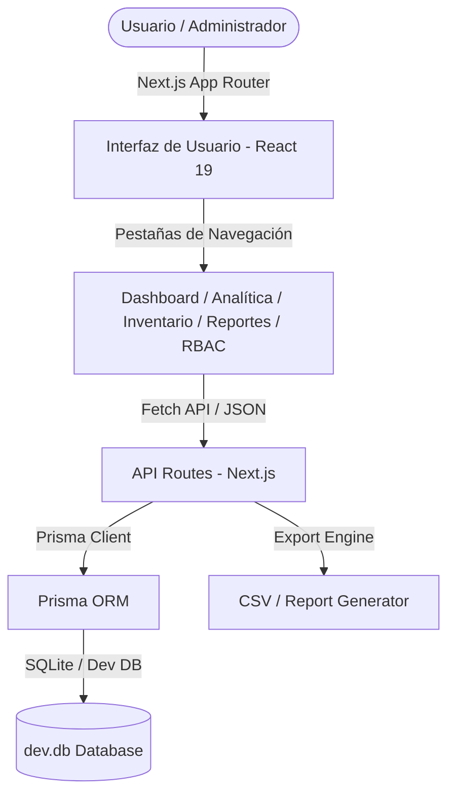

# Strata ERP — SaaS Enterprise Business Intelligence & Inventory Engine

> **Desarrolladora Web y Sistemas con Análisis de Negocio:** Jhamile Macavilca  
> **Stack Tecnológico:** Next.js 15 (App Router), React 19, TypeScript, Tailwind CSS, Prisma ORM, SQLite  
> **Repositorio Oficial:** `https://github.com/jhamile4/saas-enterprise-erp`  

---

## 📌 Visión General del Proyecto

**Strata ERP** es una plataforma SaaS de nivel empresarial diseñada bajo el enfoque de **Análisis de Negocio (Business Intelligence)** para la gestión de activos, analítica financiera en tiempo real y control inteligente de inventarios multi-almacén.

La solución resuelve la falta de visibilidad en márgenes de ganancia y los cuellos de botella en la cadena de suministro mediante un **algoritmo de alerta temprana de reorden** y un **sistema de seguridad basado en roles (RBAC)**.

---

## 🚀 Funcionalidades Principales & Módulos

### 1. 📊 Dashboard Principal & Analítica Financiera (BI)
* **Cálculo en Tiempo Real:** Visualización instantánea de MRR (Ingreso Mensual Recurrente), ARR (Ingreso Anual Recurrente), Margen Bruto General y Valoración Total del Inventario.
* **Gráficos Interactivos:** Gráficos de ingresos mensuales y análisis de tendencias con Recharts.

### 2. 📦 Motor de Inventario & Alerta de Reorden
* **Clasificación Automática de Stock:** Algoritmo que monitorea el stock actual versus el stock mínimo (`minStock`) asignando 3 estados:
  * 🟢 `NORMAL`: Stock saludable.
  * 🟡 `REORDER`: Límite de reorden alcanzado.
  * 🔴 `CRITICAL`: Riesgo inmminente de desabastecimiento.
* **Buscador & Filtros:** Filtrado instantáneo por estado de stock y búsqueda difusa por nombre/categoría.
* **Modificación en Tiempo Real:** Actualización de cantidades e inserción de nuevos productos mediante modal interactivo.

### 3. 🛡️ Sistema RBAC (Role-Based Access Control)
* **Segregación de Funciones:** 3 niveles de permisos preconfigurados:
  * **Administradora General (ADMIN):** Acceso total, visibilidad de costos de compra, creación de productos y exportación.
  * **Analista de Negocios (ANALYST):** Acceso a métricas BI y reportes; costo visible, edición restringida.
  * **Gerente de Almacén (WAREHOUSE):** Operativo; modificación de stock y alta de productos con costos financieros enmascarados por seguridad.

### 4. 📄 Centro de Reportes Ejecutivos
* Generación y simulación de descarga de reportes C-Level en **PDF y CSV** (Auditoría de Inventario, Estado Financiero, Plan de Reabastecimiento y Log de Seguridad).

---

## 📐 Arquitectura del Sistema



---

## 🛠️ Stack Tecnológico

* **Frontend:** Next.js 15.5, React 19, TypeScript, Tailwind CSS, Lucide React Icons, Recharts.
* **Backend:** Next.js API Routes (Serverless endpoints).
* **ORM & Base de Datos:** Prisma ORM 5, SQLite (`dev.db`).
* **Calidad & Herramientas:** TypeScript (Strict Mode), ESLint, Node.js.

---

## 💻 Cómo Ejecutar en Entorno Local

1. **Clonar el repositorio:**
   ```bash
   git clone https://github.com/jhamile4/saas-enterprise-erp.git
   cd saas-enterprise-erp
   ```

2. **Instalar dependencias:**
   ```bash
   npm install
   ```

3. **Inicializar la base de datos (Prisma SQLite):**
   ```bash
   npm run db:push
   ```

4. **Poblar la base de datos con datos de prueba (Seed):**
   ```bash
   npm run db:seed
   ```

5. **Iniciar el servidor de desarrollo:**
   ```bash
   npm run dev
   ```

6. **Abrir en el navegador:**
   Visita `http://localhost:3000`

---

© 2026 Jhamile Macavilca — Todos los derechos reservados.
