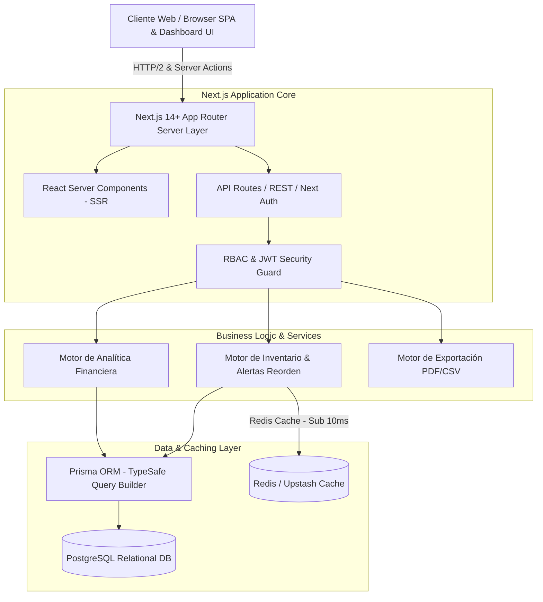

# Documento de Arquitectura de Software & Especificación de APIs

> **Proyecto:** Strata ERP — SaaS Enterprise Business Intelligence & Inventory Engine  
> **Autora & Arquitecta de Software:** Jhamile Macavilca  
> **Framework & Stack:** Next.js 14+ (TypeScript), App Router, Prisma ORM, PostgreSQL, Redis, TailwindCSS  
> **Versión:** 2.0.0  
> **Fecha:** Octubre 2026  

---

## 1. Vista de Arquitectura de Software (Fullstack Modern Architecture)

El sistema sigue una **Arquitectura Monolítica Modular / Serverless-Ready** en **Next.js 14+ (App Router)**, combinando React Server Components (RSC) para el renderizado eficiente en servidor, Server Actions / API Routes tipo REST para la lógica de negocio y comunicación de datos, y una capa de persistencia híbrida con **PostgreSQL + Prisma ORM** respaldada por **Redis** para acelerar métricas financieras (sub-10ms).



---

## 2. Modelo de Datos Entidad-Relación (Prisma Schema / PostgreSQL)

```prisma
// schema.prisma

datasource db {
  provider = "postgresql"
  url      = env("DATABASE_URL")
}

generator client {
  provider = "prisma-client-js"
}

enum Role {
  ADMIN       // Administradora General - Acceso Total
  ANALYST     // Analista de Negocios - Ver costos y reportes
  WAREHOUSE   // Gerente de Almacén - Operaciones sin ver costos
}

enum ProductStatus {
  NORMAL
  REORDER
  CRITICAL
}

model User {
  id            String    @id @default(uuid())
  name          String
  email         String    @unique
  passwordHash  String
  role          Role      @default(WAREHOUSE)
  createdAt     DateTime  @default(now())
  updatedAt     DateTime  @updatedAt

  @@map("users")
}

model Category {
  id          String    @id @default(uuid())
  name        String    @unique
  description String?
  products    Product[]
  createdAt   DateTime  @default(now())

  @@map("categories")
}

model Product {
  id          String        @id @default(uuid())
  sku         String        @unique // SKU-XXXX
  name        String
  categoryId  String
  category    Category      @relation(fields: [categoryId], references: [id])
  stock       Int           @default(0)
  minStock    Int           @default(10)
  unitCost    Decimal       @db.Decimal(10, 2)
  unitPrice   Decimal       @db.Decimal(10, 2)
  status      ProductStatus @default(NORMAL)
  createdAt   DateTime      @default(now())
  updatedAt   DateTime      @updatedAt

  @@map("products")
}
```

---

## 3. Especificación de APIs & Endpoints REST / Server Actions

### 3.1 Analítica Financiera (`/api/v1/analytics`)
* **`GET /api/v1/analytics/kpis`**
  * **Middleware:** Autenticación JWT + Permiso RBAC (`ADMIN` / `ANALYST`)
  * **Caché:** Redis TTL 60s (con invalidación programada en mutaciones de inventario)
  * **Respuesta (200 OK):**
    ```json
    {
      "mrr": 125400.00,
      "arr": 1504800.00,
      "totalInventoryValue": 1480000.00,
      "totalInventoryCost": 920000.00,
      "grossMarginPercentage": 37.84,
      "activeProducts": 142,
      "criticalStockItems": 5,
      "turnoverRate": 4.8
    }
    ```

### 3.2 Gestión de Inventarios (`/api/v1/inventory`)
* **`GET /api/v1/inventory?search=cloud&category=infra&status=CRITICAL`**
  * Retorna catálogo filtrado y paginado. Si el rol del usuario es `WAREHOUSE`, los campos `unitCost` y `grossMargin` son omitidos/enmascarados a nivel de servidor.
* **`POST /api/v1/inventory`**
  * Crea un nuevo ítem, valida SKU único, calcula estado (`NORMAL`, `REORDER`, `CRITICAL`) automáticamente e invalida la caché de analítica en Redis.

---

© 2026 Jhamile Macavilca — Especificación de Arquitectura de Software con Next.js & TypeScript.
