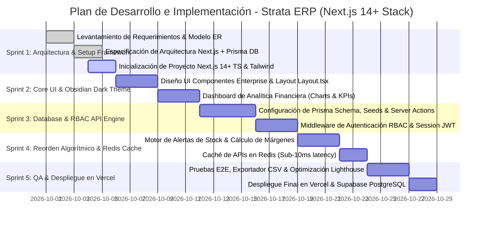

# Plan de Implementación, Sprints & Arquitectura Framework

> **Proyecto:** Strata ERP — SaaS Enterprise Business Intelligence & Inventory Engine  
> **Autora:** Jhamile Macavilca  
> **Stack Framework Elegido:** Next.js 14+ (TypeScript), App Router, TailwindCSS, Prisma ORM, PostgreSQL, Redis  
> **Versión:** 2.0.0  
> **Fecha:** Octubre 2026  

---

## 1. Plan de Implementación por Sprints (Metodología Scrum)

---

## 2. Definición del Stack Tecnológico & Framework

| Capa | Tecnología Seleccionada | Justificación Empresarial |
| :--- | :--- | :--- |
| **Framework Fullstack** | **Next.js 14+ (App Router)** | Framework #1 para React en la industria. SEO, SSR, Server Actions y API Routes integradas. |
| **Lenguaje** | **TypeScript (Strict Mode)** | Tipado estático de extremo a extremo, previniendo errores en producción y demostrando rigor técnico. |
| **Diseño & UI** | **TailwindCSS + Lucide Icons + Framer Motion** | Obsidian Dark Theme empresarial con contraste WCAG AA y micro-animaciones responsivas. |
| **ORM & Base de Datos** | **Prisma ORM + PostgreSQL** | Consultas SQL de alto rendimiento, migraciones controladas y esquemas fuertemente tipados. |
| **Caché & Performance** | **Redis (Upstash / IoRedis)** | Respuesta de endpoints de analítica financiera en menos de 10ms. |
| **Visualización de Datos** | **Recharts / Chart.js** | Gráficos ejecutivos dinámicos de MRR, ARR y tendencias de inventario. |

---

## 3. Estrategia de Despliegue Cloud (Producción)

1. **Frontend & Next.js Server:** Desplegado en **Vercel** (`https://saas-enterprise-demo.vercel.app`).
2. **Base de Datos Relacional:** Instancia PostgreSQL en **Supabase** / **Neon Tech**.
3. **Caché Distribuida:** Instancia Redis Serverless en **Upstash Redis**.

---

© 2026 Jhamile Macavilca — Plan de Implementación & Framework Next.js.
